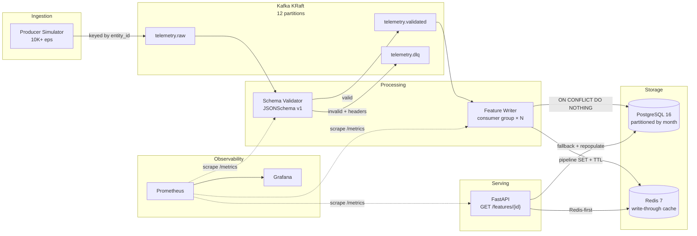

# Fault-Tolerant ML Telemetry & Feature Streaming Pipeline

A production-style, event-driven streaming pipeline that ingests simulated ML telemetry, validates schemas, persists features, and serves them with low-latency caching. Built entirely on open-source tooling and runnable locally with a single command.

---

## Architecture



---

## Quick Start

**Prerequisites:** Docker Desktop (≥ 4.x), Docker Compose V2, Python 3.11+, GNU Make.

```bash
# 1. Clone and configure
git clone <repo-url>
cd Fault-Tolerant-ML-Telementry-Feature-Streaming-Pipeline
cp .env.example .env

# 2. Start everything
make up

# 3. Run the producer (10K eps, 60s, 5% malformed)
make simulate

# 4. Check the API
curl http://localhost:8000/health
curl http://localhost:8000/features/entity-000042

# 5. View dashboards
open http://localhost:3000   # Grafana (admin/admin)
open http://localhost:9090   # Prometheus
```

---

## Component Overview

| Component | Image / Language | Port | Description |
|-----------|-----------------|------|-------------|
| Kafka (KRaft) | `confluentinc/cp-kafka:7.6.0` | 9092 | Broker + controller, no ZooKeeper |
| PostgreSQL | `postgres:16-alpine` | 5432 | Source of truth, partitioned by month |
| Redis | `redis:7-alpine` | 6379 | Write-through feature cache, LRU eviction |
| Producer | Python 3.11 | — | Generates 10K+ eps with configurable malformed % |
| Validator | Python 3.11 | 8001 | JSON Schema validation, DLQ routing |
| Feature Writer | Python 3.11 | 8002 | Batched writes via psycopg3 pipelined executemany, 500 rows per batch + Redis write-through cache |
| API | FastAPI / Python 3.11 | 8000 | Feature serving, Redis-first with PG fallback |
| Prometheus | `prom/prometheus:v2.51.0` | 9090 | Metrics scraping + alerting |
| Grafana | `grafana/grafana:10.4.0` | 3000 | Pre-provisioned dashboards |

---

## API Reference

### `GET /features/{entity_id}`
Returns the latest feature vector for a single entity.

```json
{
  "entity_id": "entity-000042",
  "event_id": "3fa85f64-5717-4562-b3fc-2c963f66afa6",
  "timestamp": "2026-10-22T14:00:00+00:00",
  "feature_vector": [0.12, -0.45, 0.78, 0.33, -0.91, 0.05, 0.67, -0.22],
  "source": "cache"
}
```

### `POST /features/batch`
Batch lookup (max 500 entities per request).

```json
// Request
{ "entity_ids": ["entity-000001", "entity-000002"] }

// Response
{
  "results": { "entity-000001": { ... }, "entity-000002": null },
  "found": 1,
  "not_found": 1
}
```

### `GET /health`
```json
{ "status": "ok", "redis": "ok", "postgres": "ok" }
```

### `GET /metrics`
Prometheus metrics in text format.

---

## Design Decisions & Trade-offs

### Delivery Guarantee: At-Least-Once + Idempotent Writes

The writer commits Kafka offsets only **after** the Postgres transaction commits. If the writer crashes mid-batch, events are re-consumed and re-written. The `ON CONFLICT (event_id, timestamp) DO NOTHING` constraint on `feature_events` ensures replays are harmless — effectively achieving exactly-once results at the application layer without the complexity of Kafka transactions spanning two systems.

**Trade-off:** Under failure/replay scenarios, the write path sees slightly more load. Offset commits are O(partitions) not O(events), so this is negligible.

### Cache Strategy: Write-Through vs Cache-Aside

Write-through was chosen over cache-aside because:
- **Cache is always warm** for recently-written entities — no cold-start thundering herd.
- **Consistency**: the write and cache update happen in the same processing step, so stale reads are bounded by the TTL (default: 1 hour).
- **Simpler read path**: the API never needs to "write" to the cache — it only reads.

**Trade-off:** Every write incurs a Redis round-trip. At 10K writes/sec, this adds ~1-2ms of pipeline latency but is mitigated by Redis pipelining per batch.

### Partitioning Strategy: Key = `entity_id`, 12 Partitions

Keying by `entity_id` guarantees **per-entity ordering** — all events for a given entity are processed sequentially by the same consumer, enabling correct `entity_latest_features` upserts without cross-consumer coordination.

12 partitions allows scaling horizontally up to 12 consumer instances before hitting the partition limit. The cooperative-sticky assignor minimizes rebalance disruption.

**Trade-off:** Hot entities (popular `entity_id`s) can cause partition skew. For this workload (random Zipfian distribution), skew is bounded.

### Offset Management: Manual Commit After DB Commit

The consumer does not auto-commit offsets. Offsets are committed only after the DB transaction succeeds. This prevents silent data loss if a writer crashes between consuming and persisting.

**Trade-off:** In crash scenarios, the last uncommitted batch is re-processed. Idempotency handles the duplicates.

---

## Benchmarks

> **Note:** Run `make up && make simulate` first to populate data, then run benchmarks individually.

### Throughput

```bash
make bench-throughput   # Runs for 5+ minutes, saves to benchmarks/results/
```

Target: **≥ 10,000 events/sec** sustained. Results are saved to `benchmarks/results/throughput_<ts>.json`.

| Metric | Result |
|--------|--------|
| Peak consume rate | *run `make bench-throughput`* |
| Avg consume rate | *run `make bench-throughput`* |
| Peak consumer lag | *run `make bench-throughput`* |
| Final consumer lag | *run `make bench-throughput`* |

### Consumer Group Tuning

```bash
make bench-tuning
```

Sweeps partition counts (1, 6, 12), writer consumer instances (1, 3, 6), and batch sizes (250, 500, 1000) with state resets between runs and warm-up bursts. Saves outputs to `benchmarks/results/tuning_<ts>.json` and `.md`.

### Read Latency (Cache ON vs OFF)

```bash
# With cache (default):
make bench-latency

# Without cache — restart API with CACHE_ENABLED=false:
CACHE_ENABLED=false docker compose up -d api
make bench-latency
```

Results are saved to `benchmarks/results/latency_<ts>.json`.

| Metric | Cache ON | Cache OFF | Improvement |
|--------|----------|-----------|-------------|
| p50 | *run benchmark* | *run benchmark* | — |
| p95 | *run benchmark* | *run benchmark* | — |
| p99 | *run benchmark* | *run benchmark* | — |

### Data Integrity

```bash
make bench-integrity
```

Produces N events (15% malformed), then verifies:
- `DLQ count == malformed count` ✓
- `Postgres rows == valid count` ✓
- `Duplicate rows == 0` ✓

### Chaos Tests

```bash
make bench-chaos
```

Kills/restarts the writer, Postgres, and Redis during peak load. After recovery, asserts zero data loss.

---

## Running Tests

```bash
# Unit tests (no infrastructure required)
make test

# Integration tests (requires 'make up' first)
make test-integration
```

---

## Configuration

All configurable via environment variables (see `.env.example`):

| Variable | Default | Description |
|----------|---------|-------------|
| `KAFKA_BOOTSTRAP_SERVERS` | `kafka:9092` | Kafka broker address |
| `KAFKA_PARTITIONS` | `12` | Main topic partition count (`telemetry.raw`, `telemetry.validated`) |
| `KAFKA_DLQ_PARTITIONS` | `3` | DLQ topic partition count (`telemetry.dlq`) |
| `POSTGRES_DSN` | `postgresql://...` | PostgreSQL connection string |
| `REDIS_URL` | `redis://redis:6379/0` | Redis connection URL |
| `CACHE_ENABLED` | `true` | Enable Redis cache in API |
| `CACHE_TTL_SECONDS` | `3600` | Redis key TTL |
| `PRODUCER_RATE` | `10000` | Target events/sec |
| `PRODUCER_DURATION` | `60` | Simulation duration (seconds) |
| `PRODUCER_MALFORMED_PCT` | `5` | Default % of malformed events to inject |
| `WRITER_BATCH_SIZE` | `500` | Events per Postgres write batch |

### Malformed Event Ingestion Ratios

| Context | Malformed % | Rationale |
|---------|:-----------:|-----------|
| Default (`.env.example`) | `5%` | Standard baseline simulation representing realistic upstream dirty data. |
| `make simulate` | `5%` | Full-rate traffic simulation (10K eps, 60s). |
| `make simulate-fast` | `${PRODUCER_MALFORMED_PCT:-5}%` | Quick local smoke test (1K eps, 10s), defaulting to baseline. |
| `bench-integrity` | `15%` | High-defect stress test to rigorously verify 100% DLQ routing and no corrupted rows in Postgres. |
| `bench-chaos` | `5%` | Validates crash recovery and at-least-once idempotency under realistic mixed-event load. |
| `bench-throughput` / `bench-tuning` | `0%` | Pure throughput/concurrency capacity testing of Kafka partitions and consumers. |

---

## Grafana Dashboards

Access at `http://localhost:3000` (admin / admin).

Pre-provisioned dashboard **"ML Telemetry Pipeline"** includes:
- Pipeline throughput (events/sec in/out)
- Consumer lag per partition
- Validation reject rate
- API p50/p95/p99 latency
- Redis cache hit ratio
- DB write latency
- DLQ depth
- Postgres connections and row throughput

---

## Directory Structure

```
.
├── producer/          # Traffic simulator (confluent-kafka, configurable rate/malformed%)
├── validator/         # Schema validation service (JSON Schema → validated/DLQ)
├── writer/            # Feature writer (batched Postgres + Redis write-through)
├── api/               # FastAPI feature serving (Redis-first, PG fallback)
├── db/                # PostgreSQL DDL (partitioned tables, indexes)
├── schemas/           # Versioned JSON Schema (telemetry_v1.json)
├── shared/            # Logging + graceful shutdown helpers
├── scripts/           # Kafka readiness probe
├── observability/     # Prometheus config, alerting rules, Grafana dashboards
├── benchmarks/        # Throughput, latency, integrity, chaos benchmarks
├── tests/             # Unit + integration tests
├── docker-compose.yml # One-command startup
├── Makefile           # up, simulate, test, bench-* targets
└── .env.example       # All configurable variables
```
